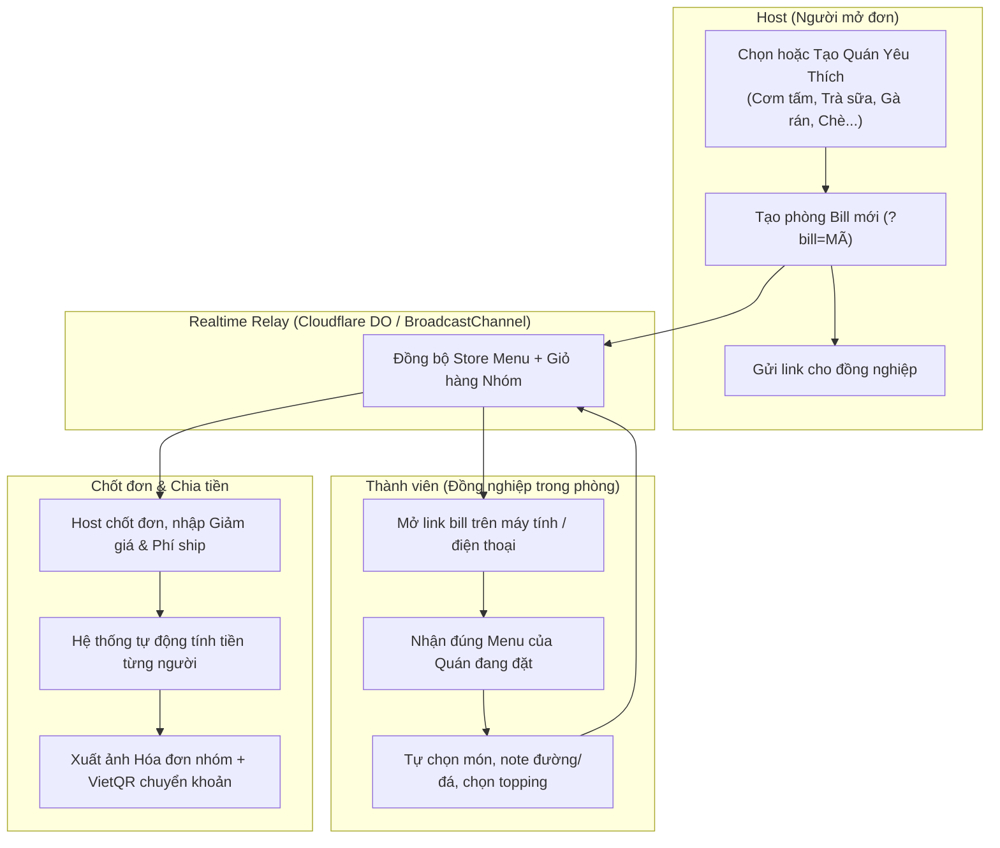

# Kế hoạch phát triển: Office Order — Hệ thống Đặt món Nhóm & Quản lý Đa Quán cho Văn Phòng

> **Domain Production:** [https://office-order.pages.dev](https://office-order.pages.dev)  
> **Mục tiêu:** Nâng cấp hệ thống từ đơn quán (Ú Ụ Milk Tea) thành nền tảng đặt món nhóm đa quán linh hoạt cho văn phòng: cho phép tạo, lưu và quản lý các quán ăn/uống yêu thích; mở phòng đặt chung realtime; tự động chia tiền và tạo mã QR thanh toán.

---

## 1. Kiến trúc Tổng thể & Dòng dữ liệu (Architecture & Data Flow)



---

## 2. Chi tiết các Giai đoạn Triển khai (Phases)

### Giai đoạn 1: Chuẩn hóa Mô hình Dữ liệu Quán (Store Schema & Storage)
- [ ] **Định nghĩa Store Schema:**
  - `id`: Mã định danh quán (vd: `uu-milktea`, `com-tam-ba-ghien`, `ga-ran-popeyes`...).
  - `name`: Tên quán (vd: "Cơm Tấm Ba Ghiền", "Trà Sữa Ú Ụ", "Trà Sữa Phê La"...).
  - `category`: Thể loại (Cơm trưa, Trà sữa, Cà phê, Ăn vặt, Bún / Phở...).
  - `icon` / `emoji`: Emoji hoặc icon đại diện (🧋, 🍱, 🍗, ☕, 🍜).
  - `bankInfo`: Thông tin nhận tiền mặc định (Ngân hàng, STK, Tên chủ TK) để sinh VietQR.
  - `categories`: Danh mục món của quán (vd: `['Cơm', 'Món thêm', 'Canh']` hoặc `['Trà sữa', 'Topping']`).
  - `items`: Danh sách món (Tên, Giá, Giá size L, Topping áp dụng, Ghi chú, Ảnh nếu có).
  - `toppings`: Danh sách topping của quán (nếu có).
- [ ] **Đóng gói quán mẫu Ú Ụ Milk Tea (`STORE_UU`):**
  - Chuyển toàn bộ 28 món trà sữa và 19 topping hiện tại thành Store mặc định đầu tiên.
  - Đảm bảo tương thích ngược 100% với dữ liệu đơn hàng hiện có.
- [ ] **Bộ quản lý Quán trên Trình duyệt (`StoreManager`):**
  - Lưu danh sách quán vào `localStorage`.
  - Hỗ trợ Import / Export file JSON để sao lưu hoặc chia sẻ bộ quán cho đồng nghiệp.

---

### Giai đoạn 2: Giao diện Chọn Quán & Tạo Quán Yêu Thích (Store UI)
- [ ] **Nút chuyển Quán (Store Selector) ở Topbar & Sidebar:**
  - Hiển thị tên quán và icon đang chọn.
  - Dropdown danh sách các quán đã lưu (bấm là chuyển menu ngay tức thì).
  - Nút **"+ Thêm quán mới"**.
- [ ] **Modal Quản lý / Tạo quán mới (`#storeModal`):**
  - **Tab 1: Thông tin chung:** Tên quán, thể loại, link quán (ShopeeFood/Grab), STK nhận tiền.
  - **Tab 2: Danh sách món (Hỗ trợ 2 chế độ):**
    - *Chế độ 1 - Form chuẩn:* Thêm từng món, nhập tên, giá tiền, size, danh mục.
    - *Chế độ 2 - Nhập nhanh siêu tốc (Quick Paste Text):* Dán danh sách món từ chat/menu dạng:
      ```text
      Cơm sườn 35k
      Cơm sườn bì chả 45k
      Canh khổ qua 10k
      Trà đá 3k
      ```
      Hệ thống tự động phân tích và tạo danh sách món chỉ trong 1 giây!
  - **Tab 3: Topping / Tùy chọn (Tùy chọn):** Bật/tắt topping hoặc tùy chọn đường/đá cho quán.

---

### Giai đoạn 3: Đồng bộ Menu Quán qua Phòng Live (Realtime Store Sync)
- [ ] **Gắn thông tin Quán vào trạng thái Phòng Bill (`orderCode`):**
  - Khi Host chọn Quán X và mở phòng `?bill=XYZ`, thông tin quán (`storeId` và snapshot menu quán) được đính kèm vào room state.
  - Đồng nghiệp chỉ cần mở link `office-order.pages.dev/?bill=XYZ`:
    - Tự động nhận đúng Menu của Quán X mà Host đã chọn.
    - Không cần đồng nghiệp phải tự tạo quán trên máy của họ.
- [ ] **Tương thích WebSocket Relay & BroadcastChannel:**
  - Giữ nguyên cấu trúc phòng theo `orderCode`.
  - Đồng bộ mượt mà giữa các tab và giữa nhiều máy khác nhau.

---

### Giai đoạn 4: Cập nhật Xuất Bill, Chia Tiền & Tạo VietQR theo Quán
- [ ] **Cập nhật Canvas Hóa Đơn Nhóm:**
  - Header hóa đơn hiển thị Tên quán đang đặt (thay vì cố định chữ "Ú Ụ Milk Tea").
  - Icon/logo hóa đơn điều chỉnh theo quán.
- [ ] **Tích hợp VietQR động:**
  - Tự động sinh mã VietQR chuyển khoản chứa: Ngân hàng, Số TK, Tên người nhận, Số tiền chính xác của từng bạn hoặc tổng bill.
  - Cho phép Host chọn: *Chuyển cho Host* HOẶC *Chuyển trực tiếp cho Quán*.
- [ ] **Tối ưu Bảng chia tiền:**
  - Tự động chia đều phí ship và giảm giá cho các bạn đã chọn món.
  - Nút Copy nhanh nội dung chuyển khoản cho từng bạn.

---

### Giai đoạn 5: Tối ưu UI/UX & Kiểm thử Toàn diện
- [ ] **Giao diện Luxury & Trải nghiệm Responsive:**
  - Tối ưu giao diện trên cả Desktop màn hình lớn và Điện thoại di động (Mobile Web).
  - Tông màu trang nhã, hiện đại, phù hợp môi trường văn phòng.
- [ ] **Kiểm thử tự động build & deploy:**
  - Chạy `bash build-live.sh` kiểm tra tính toàn vẹn của `dist-live`.
  - Push lên nhánh `main` và kiểm tra auto-deploy trên `https://office-order.pages.dev`.

---

## 3. Thứ tự Ưu tiên Triển khai (Next Action)

| Bước | Nội dung công việc | Mức độ ưu tiên | Trạng thái |
| :---: | :--- | :---: | :---: |
| **B1** | Chuẩn hóa Store Schema + Chuyển Menu Ú Ụ thành Store mẫu đầu tiên | 🔴 Cao | Sẵn sàng |
| **B2** | Làm Store Selector (Dropdown chọn quán) trên Topbar/Sidebar | 🔴 Cao | Chờ thực hiện |
| **B3** | Làm Modal Tạo Quán Mới & Bộ Parse Menu dạng Text siêu nhanh | 🟡 Trung bình | Chờ thực hiện |
| **B4** | Đồng bộ Store Data qua WebSocket Bill Room | 🟡 Trung bình | Chờ thực hiện |
| **B5** | Cập nhật Canvas Xuất Bill + VietQR theo từng quán | 🟢 Mở rộng | Chờ thực hiện |
